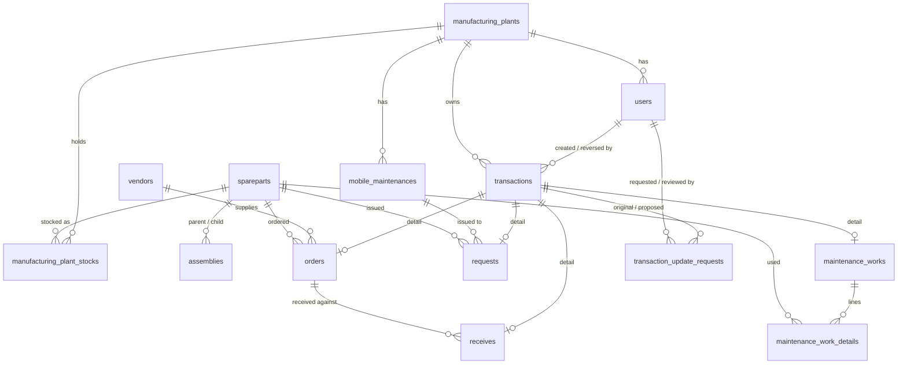

# skt-sparepart-inventory-system

A lightweight maintenance WMS built with Microsoft Excel and VBA to manage spare
parts inventory, stock movements and maintenance activities.

- **Front end:** `SIS.xlsm`, one worksheet per screen (input, update, recap, master data).
- **Database:** `SIS.accdb` (Microsoft Access), built from the SQL files in
  [src/database](src/database) by the [migration](src/database/migration/README.md).

---

## Master data

Rows are never hard deleted: archiving sets `deleted_at`, and archived rows are
hidden from pick lists.

| Master data | Table | Key / uniqueness | Notes |
| --- | --- | --- | --- |
| Manufacturing plant | `manufacturing_plants` | `code` and `name` unique | Every user, stock row, mobile maintenance and transaction belongs to exactly one plant. `type` (e.g. PLANT / WAREHOUSE) and `region` are free text. `code` starts every document number, so it cannot be changed once the plant has a transaction. |
| User | `users` | `username` unique (Windows login) | Belongs to one plant. `username` is the value stored in every `*_by` column. `tier` (≥ 0) drives approvals. |
| Vendor | `vendors` | `code` unique | Suppliers that orders are placed with. Has `name`, `company_name`, `email`. |
| Sparepart (catalogue) | `spareparts` | `code` unique | The central catalogue: `name`, `alias`, `category`, `applicable`, `unit_of_measurement`, `status`. `display` = "code - name" (calculated). |
| Mobile maintenance (mobile post) | `mobile_maintenances` | `code` and `name` unique **per plant** | The destination of every request. Two plants may both have "PM-01". |
| Plant stock | `manufacturing_plant_stocks` | one row per (plant, sparepart) | On-hand stock and reorder point planning, see [Stock and reorder point](#stock-and-reorder-point). |
| Assembly (BOM) | `assemblies` | (parent, child) unique | Links a parent sparepart to the child spareparts it is made from. A sparepart cannot be its own child. |



---

## Business process

### Transaction (document header)

Every document that touches stock has exactly one row in `transactions`, with a
one-to-one detail row in `orders`, `receives`, `requests` or `maintenance_works`.
The header holds everything that is audited:

| Column | Meaning |
| --- | --- |
| `uuid` | Document number `<PLANT>-<PREFIX>-<yyyymmdd>-<nnn>`, e.g. `SBY01-ORD-20261124-001`. `<PLANT>` is the plant's `code`; the sequence restarts each day per plant and prefix, up to 999 documents |
| `transaction_type` | `ORDER` (`ORD`), `RECEIVE` (`RCV`), `REQUEST` (`WRQ`), `MAINTENANCE` (`MTW`) |
| `manufacturing_plant_id` | The plant the document belongs to |
| `created_by`, `created_at` | Who created it, and when |
| `activated_at` | When it became active. Empty = draft (a proposed edit waiting for approval) |
| `reversed_by`, `reversed_at` | Who cancelled it, and when |
| `signed_at`, `digital_signature` | Reserved for a digital signature in the future |
| `synced_by`, `synced_at` | Reserved for synchronisation |

Lifecycle:

| State | Condition | Counts in stock and reports |
| --- | --- | --- |
| Draft | `activated_at` is empty | No |
| Active | `activated_at` set, `reversed_at` empty | **Yes** |
| Reversed | `reversed_at` set | No |

**A transaction is never edited or deleted.** A correction is a new draft
transaction that goes through an [update](#update). To delete a document, the
update sets its quantity to **0** (order and request `quantity`, receive
`received_quantity`). A deleted line does not show on the stock card. New
documents should have a quantity above 0.

### Incoming

#### 1. Order (`ORD`)

The first step of incoming goods: spareparts ordered from a vendor. An order does
**not** add stock.

Each order row (`orders`) stores:

1. Sparepart
2. Vendor
3. PO number (SAP PO, often known later than the order itself)
4. Order date
5. Quantity (≥ 0, 0 = deleted); the unit of measurement comes from the sparepart
6. Remarks
7. System remarks (filled by the system for special cases, otherwise empty)
8. Person in charge

The PO number is the **only** order field that may be filled in or corrected
directly (`order_set_po_number`). Any other change needs an update request.

Order delivery status (`vw_order_progress`), based on active receives:

| Status | Rule |
| --- | --- |
| `BELUM DATANG` | Nothing received yet |
| `DATANG SEBAGIAN` | Received, but OK quantity < ordered quantity |
| `DATANG SEMUA` | OK quantity ≥ ordered quantity |

`remaining_quantity` = ordered − OK quantity received. Orders with a remaining
quantity appear on the pending order recap and can be received.

#### 2. Receive (`RCV`)

Goods arriving against an order are counted and verified. One order can have
several receives (partial deliveries).

Each receive row (`receives`) stores:

1. Order it belongs to
2. Arrival date
3. Verification date
4. Received quantity
5. OK quantity
6. NOT OK quantity
7. Remarks
8. System remarks
9. Person in charge

Rules:

- Received quantity = OK quantity + NOT OK quantity.
- The order must be active (not a draft and not reversed).
- `remaining_quantity_before` on the receive recap counts the earlier receives of
  the same order by arrival date, so a corrected receive keeps its place.
- **Only the OK quantity enters stock**, dated on the verification date. A receive
  without a verification date does not move stock yet.

### Outgoing

#### Request (`WRQ`)

Spareparts issued from the plant store to a mobile maintenance. A request
**reduces** stock on its request date.

Each request row (`requests`) stores:

1. Mobile maintenance (destination, from the same plant)
2. Sparepart
3. Request date
4. Quantity (≥ 0, 0 = deleted); the unit of measurement comes from the sparepart
5. Remarks
6. System remarks
7. Person in charge

Rule: a request is refused when the plant does not have enough stock of the
sparepart: the stock card may not go negative on the request date **or any later
day** (`stock_ledger_get_available`). This matters for a backdated request, which
today's `current_stock` alone does not cover.

### Maintenance work (`MTW`)

A maintenance job done by a mobile maintenance on a date (`maintenance_works`:
name, date, type such as PREVENTIVE / CORRECTIVE). Its lines
(`maintenance_work_details`) record each task performed and, optionally, the
sparepart and amount used.

> Schema only for now: there is no screen or service yet, and there is no
> `maintenance_tasks` master table yet.

### Update

An active document is never changed in place. A correction is a **new document**
that replaces the old one once a higher-tier user approves it. The old document
stays in the database as reversed, so the history is never lost.

The one exception is the **PO number of an order**: it can be filled in or
corrected directly from the order recap, without approval, and is logged as
`Order.SetPoNumber`.

#### Update flow

| Step | Who | What happens |
| --- | --- | --- |
| 1. Propose | Any user | The corrected values are saved as a new **draft** document (new document number) and a pending row in `transaction_update_requests` (original, proposed, reason, requested by / at). Nothing else changes: stock, order progress and the original document stay as they were. |
| 2. Review | A user with a **higher tier** than the requester, not archived | The reviewer compares the original and the proposed document and gives the verdict, with an optional decision note. |
| 3a. Approve | Reviewer | In **one** database transaction: the update request is marked `APPROVED`, the original is reversed, the proposed document is activated, and the follow-up for that document type runs (see below). If any step fails, nothing is saved. |
| 3b. Reject | Reviewer | The update request is marked `REJECTED` and the proposed draft is reversed, so it can never be activated. The original stays active and can be proposed for update again. |

| Update request | `verdict` | Original document | Proposed document |
| --- | --- | --- | --- |
| Pending | empty | Active | Draft |
| Approved | `APPROVED` | Reversed | Active |
| Rejected | `REJECTED` | Active | Reversed |

Rules:

- The original must be **active**. A draft or reversed document cannot be updated.
- The proposed document is the same type and the same plant as the original.
- A proposed request is checked with `stock_ledger_get_available`. The original's
  quantity is added back only when the original is dated on or before the
  proposed date.
- The reviewer cannot be the requester; the reviewer's `tier` must be higher.
- Every step is written to the activity log (`*.CreateUpdateProposal`,
  `*.UpdateRequest.Approve`, `*.UpdateRequest.Reject`), with the log JSON of the
  proposed document and its `original_uuid`.

#### Order update — receives follow the order

Receives point to an order (`receives.order_id`). When an order is replaced, its
receives must follow it, otherwise the goods already delivered would belong to a
reversed order and the new order would look as if nothing had arrived.

On **approval** of an order update, in the same database transaction:

1. The original order is reversed and the proposed order is activated.
2. **Every receive of the original order is moved to the new order**
   (`receive_reassign_order`). This includes receive drafts that are still waiting
   for their own update approval, so they also land on the new order.
3. The receives keep their own document numbers (`<PLANT>-RCV-...`), dates and OK / NOT OK
   quantities. Only the order they belong to changes, so no receive is reversed or
   re-entered.
4. Order progress is recalculated against the new order: received and OK totals
   come from the moved receives, and the status (`BELUM DATANG` /
   `DATANG SEBAGIAN` / `DATANG SEMUA`) and remaining quantity follow the new
   ordered quantity.
5. If the **sparepart** changed, the stock IN of the moved receives now counts for
   the new sparepart. Stock is recalculated for the old **and** the new sparepart.
6. The log records the number of receives moved.

Before approval (pending) and after rejection, receives stay on the original
order. A receive is never moved while the order update is only proposed.

The plant of an order cannot change through an update: receives can only move
between orders of the same plant.

#### Receive update

On approval the original receive is reversed and the proposed one is activated.
The proposed receive must still satisfy received = OK + NOT OK. Stock is
recalculated for the sparepart of the original and, if different, of the proposed
receive. The order's progress follows automatically, because it only counts active
receives.

#### Request update

On approval the original request is reversed and the proposed one is activated.
Stock is recalculated for the sparepart of the original and, if different, of the
proposed request. The plant must still have enough stock for the proposed quantity.

### Stock and reorder point

The stock ledger (`vw_stock_ledger`) is built only from
**active** transactions:

| Direction | Source | Date |
| --- | --- | --- |
| IN | OK quantity of a receive | verification date |
| OUT | quantity of a request | request date |

`manufacturing_plant_stocks.current_stock` is a cache of that ledger, kept in step
by the application and never negative. A plant gets a zero stock row for every
catalogue sparepart it does not have yet (`manufacturing_plant_stock_create_missing`).

Reorder point per (plant, sparepart), rounded up to whole units:

```text
safety_stock  = service_level_z × daily_demand_std_dev × √lead_time_days
reorder_point = safety_stock + average_daily_usage × lead_time_days
```

`service_level_z` defaults to 1.65 (95 % service level).

### Activity log

Every create, update request, approval and master data change writes one row to
`activity_logs` in the same database transaction as the change itself:

- `activity_code`, e.g. `Order.Create`, `Order.CreateUpdateProposal`,
  `Order.SetPoNumber`, `Receive.Create`, `Request.Create`,
  `Order.UpdateRequest.Approve`, `Vendor.Create`, `PlantStock.UpdateROP`
- `detail`: human-readable text
- `json`: the document's data as JSON, following the database structure (below)
- `username`, `created_at`

`username` is deliberately not a foreign key, so a log row outlives its user.

#### Log JSON

Every order, receive and request writes its data to `activity_logs.json`. The
keys follow the table columns, and every foreign key is written as the
referenced row's `code` and `name`, so the log is still readable if master data
changes later. A proposed edit (`*.CreateUpdateProposal`) logs the proposed
document with `"original_uuid"` added.

**Order** (`Order.Create`)

```json
{
    "uuid": "SBY01-ORD-20261124-001",
    "transaction_type": "ORDER",
    "manufacturing_plant": { "code": "", "name": "" },
    "sparepart": { "code": "", "name": "", "unit_of_measurement": "" },
    "vendor": { "code": "", "name": "" },
    "po_number": "",
    "order_date": "2026-11-24",
    "quantity": 0,
    "remarks": "",
    "system_remarks": "",
    "person_in_charge": ""
}
```

**Receive** (`Receive.Create`)

```json
{
    "uuid": "SBY01-RCV-20261124-001",
    "transaction_type": "RECEIVE",
    "order": { "uuid": "SBY01-ORD-20261124-001", "po_number": "" },
    "manufacturing_plant": { "code": "", "name": "" },
    "sparepart": { "code": "", "name": "", "unit_of_measurement": "" },
    "arrival_date": "2026-11-24",
    "verification_date": "2026-11-24",
    "received_quantity": 0,
    "ok_quantity": 0,
    "not_ok_quantity": 0,
    "remarks": "",
    "system_remarks": "",
    "person_in_charge": ""
}
```

**Request** (`Request.Create`)

```json
{
    "uuid": "SBY01-WRQ-20261124-001",
    "transaction_type": "REQUEST",
    "manufacturing_plant": { "code": "", "name": "" },
    "mobile_maintenance": { "code": "", "name": "" },
    "sparepart": { "code": "", "name": "", "unit_of_measurement": "" },
    "request_date": "2026-11-24",
    "quantity": 0,
    "remarks": "",
    "system_remarks": "",
    "person_in_charge": ""
}
```

---

## Project structure

```text
SIS.xlsm                     Excel front end
SIS.accdb                    Access database
src/
├─ apps/
│  ├─ views/                 sheet modules (sheet*.cls) and ThisWorkbook: events only
│  ├─ forms/                 formTanggal (date picker, .frm + .frx)
│  ├─ models/                entity classes (Order, Receive, Request, Sparepart, ...)
│  └─ modules/
│     ├─ core/               config, helpers, JSON, application start (coreApp)
│     ├─ managers/           database, error, form, table, validation, sheet,
│     │                      list (dropdowns), paging, navigation, email
│     ├─ controllers/        one per sheet: reads / writes cells, calls services
│     ├─ services/           business rules, one DB transaction per entry point
│     └─ dao/                one function per saved Access query
└─ database/
   ├─ tables/                one CREATE TABLE file per table (00–15)
   ├─ queries/               saved queries and views (vw_*)
   └─ migration/             builds the .accdb, see its README
```

---

## Excel application

### Layers

```text
Sheet (event) -> Controller -> Service -> DAO -> managerDatabase -> SIS.accdb
```

| Layer | Does | Does not |
| --- | --- | --- |
| Sheet module (`views/sheet*.cls`) | Forwards `Activate`, `BeforeDoubleClick` and `Change` to its controller; the sidebar is handled first | Any logic |
| Controller (`controllers/`) | Reads and checks cells, fills tables, dropdowns, paging, messages | SQL, business rules |
| Service (`services/`) | Business rules, one database transaction per public entry point, activity log | Touch cells |
| DAO (`dao/`) | Runs exactly one saved query and maps rows to models | Open, commit or roll back |

### Setting up the workbook

1. In the VBA editor (Alt+F11): **Tools > References** and tick
   **Microsoft ActiveX Data Objects 6.1 Library**.
2. Import every `.bas` from `src/apps/modules` and every `.cls` from
   `src/apps/models` and `src/apps/modules/managers/PagingManager`, and
   `src/apps/forms/formTanggal.frm` (keep `formTanggal.frx` next to it).
3. Paste the code of each `src/apps/views/sheet*.cls` into the sheet with the
   same code name (`sheetInputOrder` = INPUT_ORDER, ...) and
   `ThisWorkbook.cls` into ThisWorkbook.
4. Put `SIS.accdb` next to `SIS.xlsm`, re-run `RunMigration` (see the
   [migration README](src/database/migration/README.md)) so the saved queries
   are current, and add at least one plant in Access
   (`manufacturing_plants`).
5. Open the workbook, choose the plant in **SETTINGS > LOKASI** and register
   your Windows user in **MASTER DATA USER**: every document stores who made
   it.

A database built before quantity 0 meant "deleted" still has
`quantity > 0` checks on `orders` and `requests`. The migration does not
change existing constraints, so run this once in Access (SQL view, ANSI-92):

```sql
ALTER TABLE orders DROP CONSTRAINT ck_orders_quantity;
ALTER TABLE orders ADD CONSTRAINT ck_orders_quantity CHECK (quantity >= 0);
ALTER TABLE requests DROP CONSTRAINT ck_requests_quantity;
ALTER TABLE requests ADD CONSTRAINT ck_requests_quantity CHECK (quantity >= 0);
```

### Using the sheets

- **Clickable cells are double-clicked**: menu rows in the sidebar, buttons
  (SIMPAN, CARI, TAMBAH BARIS, ...) and the action columns of tables
  (EDIT, HAPUS, CHECK, SIMPAN PO ID, SIMPAN).
- **Dates** are picked with the date form: double-click any date cell.
- **Plants, spareparts, vendors and mobile posts** are dropdowns. Sparepart,
  vendor and mobile post dropdowns show and pass the display value
  `code - name` (e.g. `V0001 - PT MAJU`). The sparepart list is
  `MD_SPAREPART[DISPLAY]`; the vendor and mobile post lists are kept on the
  hidden sheet `LISTS` and rewritten whenever `MD_VENDOR` / `MD_POS_MOBILE`
  are refreshed (those tables have no DISPLAY column). Plants come from
  Access into `LISTS` on open. The POS MOBILE list shows the plant of the
  request sheet in use. New vendors get the code `V0001`, `V0002`, ...
- **Recap sheets** (CARI): BARIS DATA / TOTAL HALAMAN show the result,
  SEBELUMNYA / SELANJUTNYA page through it, FILTER PENCARIAN (KOLOM + NILAI)
  and BARIS YANG DITAMPILKAN filter and size the pages without another query.
- **Corrections** follow the [update flow](#update): EDIT makes a row editable
  (yellow) and shows AJUKAN; AJUKAN asks the reason and saves the proposal;
  BATAL restores the row; HAPUS proposes quantity 0. Proposals are approved or
  rejected on **REQUEST UPDATE** (CHECK shows old and new values).
- **PO ID** is saved directly (REKAP ORDER: type it; PENDING ORDER and INPUT
  PENERIMAAN: type it and save).
- **KIRIM EMAIL** (INPUT ORDER) writes an unsent `.eml` email (in
  `%TEMP%\SIS Email`) with the orders in the table (or the last saved orders)
  for the TO / CC / BCC lists on SETTINGS and opens it with the default mail
  app, so it works with the new Outlook. Make Outlook the default app for
  `.eml` files (Windows Settings > Apps > Default apps).
